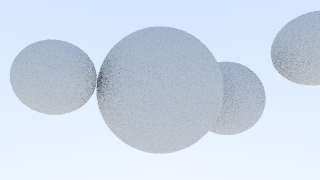
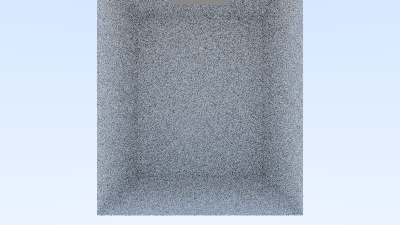
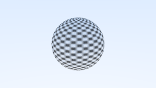

# Graphics Rendering Lab

从 CPU 路径追踪到 Vulkan 实时渲染的 C++ 学习与工程实践。

**A C++ graphics learning portfolio: a CPU path tracer and an evolving Vulkan renderer.**

本仓库收录 2026-11-17 的阶段源码。两个渲染器独立构建，展示当前可运行入口、实现范围和仍待完成的部分。

| 项目 | 当前内容 | 构建与运行 |
|---|---|---|
| CPU 路径追踪 | 材质散射、相机、球与平行四边形、BVH、tile 多线程、程序化纹理、PPM 输出 | [CPU 使用说明](cpu/README.md) |
| Vulkan 渲染 | 窗口与交换链、资源上传、OBJ 网格、深度与相机、法线可视化、直接光 GGX 着色；材质与颜色空间工作进行中 | [Vulkan 使用说明](vulkan/README.md) |

## CPU 代表输出

以下是 **2026-10-14 保存的历史代表输出**，用于展示已实现的场景。图像保留原始分辨率与采样噪声，未做去噪或美化；它们不是本次打包验证新生成的图。

| 多球场景 | Cornell 场景 | 程序化棋盘纹理 |
|---|---|---|
|  |  |  |
| 320 × 180 | 400 × 225 | 320 × 180 |

图像来源及本次验证范围见[快照说明](docs/SNAPSHOT.md)。Vulkan 本版提供源码与复现步骤，尚未收录与这份快照对应的运行截图。

## 从哪里开始

- **查看 CPU 实现**：从 [`cpu/src/main.cpp`](cpu/src/main.cpp) 的场景分派进入；用内置 `exam` 做最小自检，再运行 Cornell 或 checker 场景。
- **查看 Vulkan 实现**：从 [`vulkan/main.cpp`](vulkan/main.cpp) 的命令行入口进入；窗口路径组织设备、交换链、资源上传、绘制与重建。
- **复现构建**：两个子目录各有独立 `CMakeLists.txt`。CPU 使用 C++17 与线程库；Vulkan 当前要求 Windows、MSVC x64、Vulkan SDK 与 GLFW。

```text
graphics-rendering-lab/
├── cpu/                       CPU 源码、CMake 与使用说明
├── vulkan/                    Vulkan 源码、着色器、示例模型与依赖声明
│   ├── assets/
│   ├── shaders/
│   └── third_party/
├── assets/cpu/                精选历史展示图
└── docs/                      阶段范围、验证与来源说明
```

## 阶段边界

CPU 模块保留内置测试入口，但测试结果不等于性能收益或所有场景均已验证。当前没有显式光源采样 / MIS、去噪或交互式预览。

Vulkan 的直接光阶段已有开发期验证记录；材质和颜色空间阶段仍在推进。当前代码还包含固定的设备选择与部分着色参数。本次整理只对该副本做离线构建，不把编译成功表述为 GPU 运行通过。具体限制见 [Vulkan README](vulkan/README.md)。

## 来源与贡献

CPU 工程以 [Ray Tracing in One Weekend](https://raytracing.github.io/) 系列为学习基础，逐步扩展场景、BVH、多线程及验证功能。开发过程包括本人实现与操作，以及 AI 教学、局部实现辅助、验证、构建接线和文档整理。该仓库展示工程成果，不将全部代码表述为独立原创。

第三方组件及参考来源见 [THIRD_PARTY_NOTICES](docs/THIRD_PARTY_NOTICES.md)。**本项目整体许可证尚待作者确认**；随仓库分发的第三方许可证保持原文。
